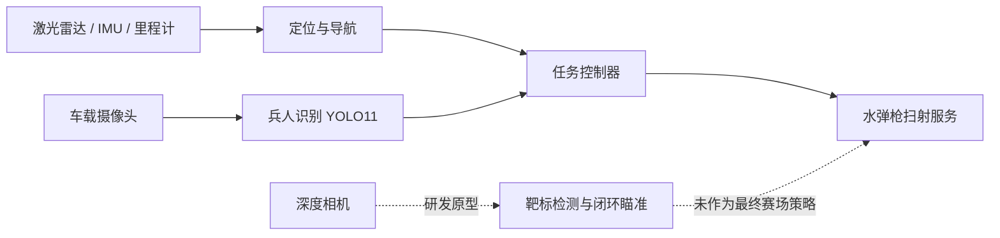

# RAICOM 2025 智能侦察车

2025 年睿抗机器人开发者大赛智能侦察项目归档。项目围绕一台 ROS 智能车完成了自主导航、兵人识别和水弹枪任务协同。

> 这是经过筛选的竞赛技术展示，不是原始工作盘镜像，也不是未经硬件检查即可启动的产品。

## 做了什么

- 使用 ROS Melodic、AMCL、Dijkstra 全局规划和 DWA 局部规划完成场地导航。
- 使用 YOLO11 识别敌方、友方和人质兵人牌，并按区域统计结果。
- 实现过基于深度相机的靶标检测和闭环瞄准原型。
- 最终根据实车算力、SLAM 卡顿和电量约束，采用计算量更低的固定范围扫射方案。



## 结果

下表来自保留训练记录的最后一轮验证结果，不代表独立测试集或赛场成绩。

| 模块 | 模型 | Precision | Recall | mAP50 | mAP50-95 |
|---|---|---:|---:|---:|---:|
| 兵人识别 | YOLO11s | 0.977 | 0.980 | 0.975 | 0.743 |
| 水弹枪靶标 | YOLO11n | 0.985 | 0.973 | 0.993 | 0.746 |

| 兵人识别训练曲线 | 靶标识别训练曲线 |
|---|---|
|  |  |

## 核心代码

- `robot/ros_ws/src/nav_demo/scripts/mission_controller.py`：赛道点位、分区导航参数、识别和扫射接口。
- `robot/ros_ws/src/nav_demo/scripts/soldier_detector.py`：单帧采集、YOLO 推理和三类角色统计。
- `robot/ros_ws/src/nav_demo/scripts/gun_sweep_server.py`：带参数校验和默认禁用保护的扫射服务。
- `robot/prototype/auto_aim_controller.py`：深度相机闭环瞄准原型。
- `vision/soldier/` 与 `vision/target/`：可移植的训练、推理和评估入口。

## 仓库结构

```text
.
├─ docs/                  架构、工程取舍、复现边界和整理记录
├─ media/training/        训练曲线、PR 曲线和归一化混淆矩阵
├─ models/                三份可追溯权重（Git LFS）
├─ robot/
│  ├─ prototype/          未进入最终赛场策略的闭环瞄准原型
│  └─ ros_ws/src/         精简后的 catkin 工作区源码
├─ tools/                 不依赖 ROS 的仓库完整性检查
└─ vision/                两个视觉任务的训练、推理和评估入口
```

## 快速查看视觉模型

```bash
git lfs install
git clone <your-repository-url>
cd <repository>

python3 -m venv .venv
source .venv/bin/activate
pip install -r requirements.txt

python vision/soldier/infer.py path/to/image.jpg
python vision/target/infer.py path/to/image.jpg
```

训练与评估需要自行准备数据，并将 `data.example.yaml` 中的占位路径改为本机路径。原始数据集没有公开。

## ROS 复现边界

ROS 代码来自比赛实车备份，目标环境是 Ubuntu 18.04 + ROS Melodic。公开版保留团队编写的任务包、底盘包、机器人描述和最终配置；雷达、IMU 等厂商驱动没有复制，请根据 `docs/REPRODUCIBILITY.md` 单独安装。

```bash
cd robot/ros_ws
catkin_make
source devel/setup.bash
python3 ../../tools/validate_repo.py
```

上述命令用于说明工作区结构，不代表已在当前整理环境完成整车联调。地图、串口、摄像头编号、USB 规则和传感器型号必须按实际硬件确认。

## 安全说明

`gun_sweep_server.py` 默认 `~armed:=false`，不会接受开火请求。任何水弹发射装置测试都应断开弹药、设置物理安全区，并准备独立急停。不要在人员、动物、玻璃或非授权场地附近测试。

## 说明与许可

- 此仓库不包含成员身份信息、国赛报告、主办方资料、原始数据集和实车人物照片。
- Ultralytics 依赖及其许可证说明见 `NOTICE.md` 和 `third_party/licenses/`。
- 团队原创代码尚未选择开源许可证。在添加正式 `LICENSE` 前，本仓库仅用于作品展示与技术交流，不自动授予复制、修改或再分发权利。
- 公开前请完成 `docs/PUBLICATION_CHECKLIST.md`。

更多内容：[`系统架构`](docs/ARCHITECTURE.md) · [`工程取舍`](docs/DESIGN_DECISIONS.md) · [`复现说明`](docs/REPRODUCIBILITY.md) · [`模型卡`](models/MODEL_CARD.md)
