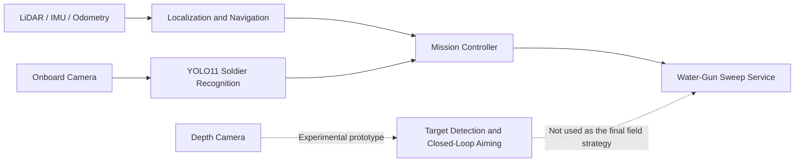

# RAICOM 2025 Intelligent Reconnaissance Vehicle

English | [简体中文](README.zh-CN.md)

An archived project from the 2025 RAICOM Robot Developer Competition. The system combines ROS-based autonomous navigation, YOLO11 soldier-board recognition, and water-gun task control on a mobile robot.

> This repository is a curated technical showcase, not a mirror of the original development drive or a plug-and-play hardware release.

## What it does

- Navigates the competition field with ROS Melodic, AMCL, Dijkstra global planning, and DWA local planning.
- Detects enemy, friendly, and hostage soldier boards with YOLO11 and records per-zone counts.
- Includes a depth-camera-assisted closed-loop aiming prototype developed during experimentation.
- Uses a deterministic sweep strategy in the final competition configuration to reduce compute load, SLAM disruption, and power consumption.



## Results

The following values come from the final validation epoch in the retained training logs. They are not independent test-set scores or competition-field accuracy measurements.

| Task | Model | Precision | Recall | mAP50 | mAP50-95 |
|---|---|---:|---:|---:|---:|
| Soldier-board recognition | YOLO11s | 0.977 | 0.980 | 0.975 | 0.743 |
| Water-gun target detection | YOLO11n | 0.985 | 0.973 | 0.993 | 0.746 |

| Soldier recognition training | Target detection training |
|---|---|
|  |  |

## Key code

- `robot/ros_ws/src/nav_demo/scripts/mission_controller.py` — route waypoints, zone-specific navigation parameters, recognition hooks, and sweep-service integration.
- `robot/ros_ws/src/nav_demo/scripts/soldier_detector.py` — one-frame capture, YOLO inference, and three-role counting.
- `robot/ros_ws/src/nav_demo/scripts/gun_sweep_server.py` — sweep service with input validation and a safe, disarmed-by-default configuration.
- `robot/prototype/auto_aim_controller.py` — depth-camera closed-loop aiming prototype.
- `vision/soldier/` and `vision/target/` — portable training, inference, and evaluation entry points.

## Repository layout

```text
.
├─ docs/                  Architecture, engineering decisions, and reproduction notes
├─ media/training/        Training curves, PR curves, and normalized confusion matrices
├─ models/                Three traceable model weights managed with Git LFS
├─ robot/
│  ├─ prototype/          Closed-loop aiming experiment not used in the final strategy
│  └─ ros_ws/src/         Curated catkin workspace source
├─ tools/                 Repository validation without ROS or ML imports
└─ vision/                Training, inference, and evaluation for both vision tasks
```

## Quick model demo

```bash
git lfs install
git clone <your-repository-url>
cd <repository>

python3 -m venv .venv
source .venv/bin/activate
pip install -r requirements.txt

python vision/soldier/infer.py path/to/image.jpg
python vision/target/infer.py path/to/image.jpg
```

Training and evaluation require a local dataset. Replace the placeholder paths in the relevant `data.example.yaml`; the original datasets are not published.

## ROS reproduction boundary

The robot code was recovered from the competition vehicle backup and targeted Ubuntu 18.04 with ROS Melodic. This public edition retains the project-specific mission package, chassis package, robot description, and final configuration. LiDAR, IMU, and other vendor drivers are external dependencies; see [`docs/REPRODUCIBILITY.md`](docs/REPRODUCIBILITY.md).

```bash
cd robot/ros_ws
catkin_make
source devel/setup.bash
python3 ../../tools/validate_repo.py
```

These commands describe the workspace structure; they do not claim a newly verified full-vehicle deployment. Map selection, serial ports, camera indices, USB rules, sensor models, and calibration must be checked against the actual hardware.

## Safety

`gun_sweep_server.py` starts with `~armed:=false` and rejects firing requests by default. Any test involving a water-projectile launcher must be performed unloaded first, inside a controlled safety area, with an independent emergency stop. Never test near people, animals, glass, or an unauthorized site.

## Publication and licensing

- The repository excludes team identity documents, the national-final report, organizer-provided files, raw datasets, and vehicle photos containing people.
- Ultralytics and third-party notices are documented in `NOTICE.md` and `third_party/licenses/`.
- No open-source license has been selected for the project-authored code. Until a top-level `LICENSE` is added, this repository is provided for portfolio display and technical discussion and does not automatically grant reuse rights.
- Review [`docs/PUBLICATION_CHECKLIST.md`](docs/PUBLICATION_CHECKLIST.md) before changing the repository to public.

Further reading: [Architecture](docs/ARCHITECTURE.md) · [Engineering decisions](docs/DESIGN_DECISIONS.md) · [Reproducibility](docs/REPRODUCIBILITY.md) · [Model card](models/MODEL_CARD.md)
