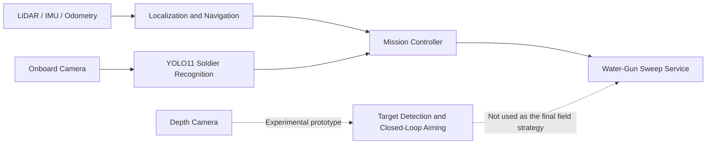
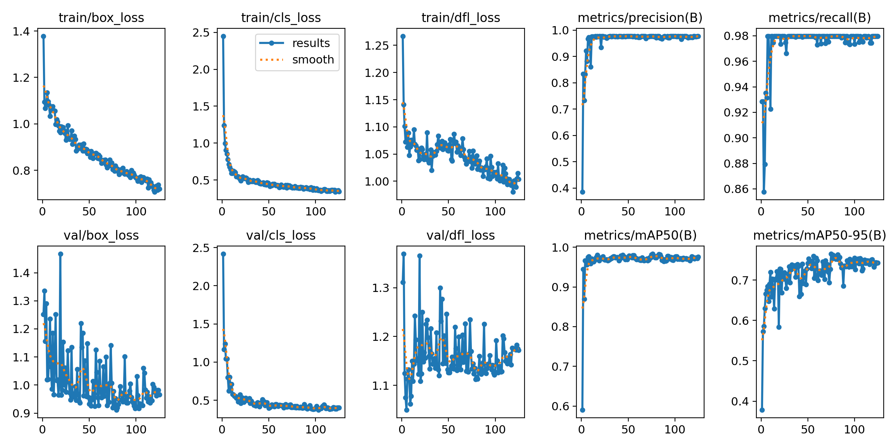
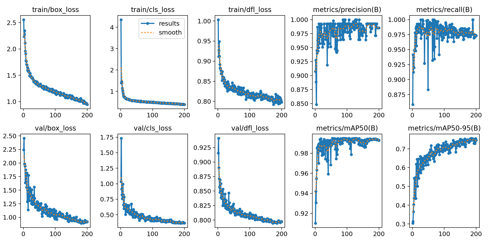
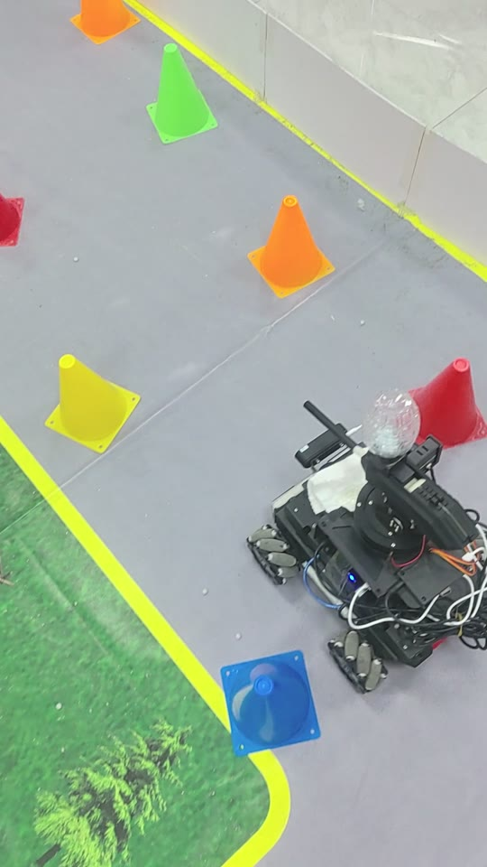
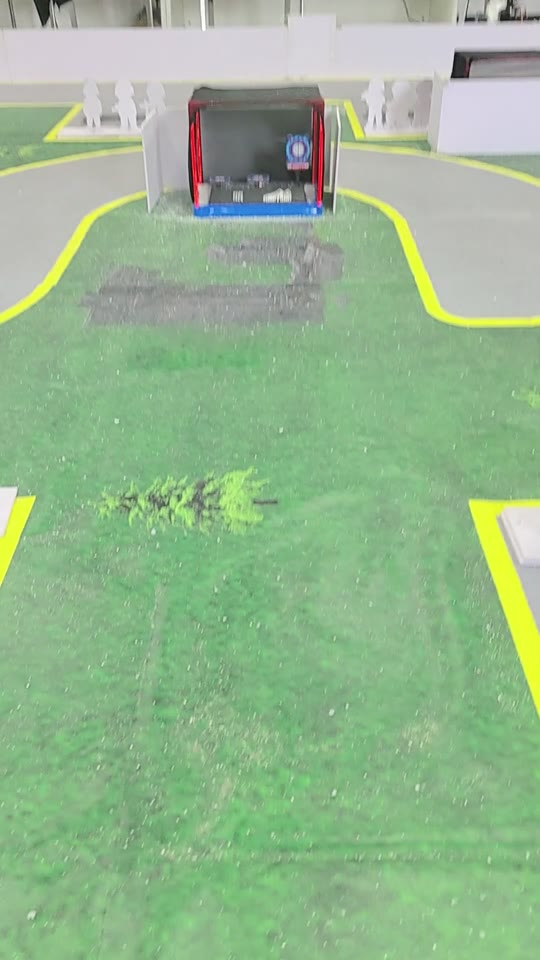

# RAICOM 2025 Intelligent Reconnaissance Vehicle

English | [简体中文](README.zh-CN.md)

An engineering case study and curated archive from the 2025 RAICOM Robot Developer Competition. The original vehicle combined ROS-based autonomous navigation, YOLO11 soldier-board recognition, and water-gun task control.

> This repository preserves representative source code, model artifacts, training records, and engineering decisions. It is not a complete reconstruction of the original development drive, a reproducible robot stack, or a deployable hardware release.

## Archive status

| Component | Status |
|---|---|
| Model weights | Preserved, hash-verified, and stored with Git LFS |
| Training records and plots | Preserved; headline metrics checked against the retained CSV files |
| Vision entry points | Source available; not rerun in the current archive environment |
| ROS navigation and mission source | Historical reference; not rebuilt or tested on the original vehicle after curation |
| Closed-loop aiming prototype | Incomplete experimental artifact; external YOLOv5 code and calibration data are not included |
| Full vehicle deployment | Not reproducible without the original hardware, drivers, calibration, and runtime environment |
| Raw datasets | Not published because redistribution permission and privacy could not be fully verified |

## 2025 system scope

- The competition vehicle used ROS Melodic, AMCL, Dijkstra global planning, and DWA local planning for field navigation.
- YOLO11 models detected enemy, friendly, and hostage soldier boards and supported per-zone counting.
- A depth-camera-assisted closed-loop aiming pipeline was explored during development.
- The final engineering decision favored a deterministic sweep strategy to reduce compute load, SLAM disruption, and power consumption.

The diagram below summarizes the historical system design; it is not an executable call trace of the retained source tree.



## My contribution

The repository owner was the primary developer and system integrator for this project. The work covered:

- ROS navigation setup, waypoint sequencing, and field-specific parameter tuning;
- soldier-board and target data preparation, YOLO training, evaluation, and model selection;
- camera inference, per-zone role counting, and integration with the mission flow;
- depth-camera aiming experiments and the final sweep-control implementation;
- vehicle integration, field debugging, and the compute, SLAM-stability, and battery trade-offs behind the final strategy.

## Results

The following values come from the final validation epoch in the retained training logs. They are not independent test-set scores or competition-field accuracy measurements.

| Task | Model | Precision | Recall | mAP50 | mAP50-95 |
|---|---|---:|---:|---:|---:|
| Soldier-board recognition | YOLO11s | 0.977 | 0.980 | 0.975 | 0.743 |
| Water-gun target detection | YOLO11n | 0.985 | 0.973 | 0.993 | 0.746 |

| Soldier recognition training | Target detection training |
|---|---|
|  |  |

## Field demonstration

Two short clips from the competition development vehicle. The first shows autonomous obstacle avoidance during a course run; the second shows the water-gun target-shooting task. No people or identifiable venue markers appear in the footage.

| Obstacle avoidance | Target shooting |
|---|---|
| [](media/demo/obstacle_avoidance.mp4) | [](media/demo/target_shooting.mp4) |

_Click a thumbnail to play the video._

## Key code

- `robot/ros_ws/src/nav_demo/scripts/mission_controller.py` — retained route waypoints, zone-specific navigation parameters, recognition hooks, and historical sweep-service integration points; the active archived path is incomplete.
- `robot/ros_ws/src/nav_demo/scripts/soldier_detector.py` — one-frame capture, YOLO inference, and three-role counting.
- `robot/ros_ws/src/nav_demo/scripts/gun_sweep_server.py` — sweep service with input validation and a safe, disarmed-by-default configuration.
- `robot/prototype/auto_aim_controller.py` — reference-only depth-camera aiming prototype; its external YOLOv5 runtime and calibration data are not included.
- `vision/soldier/` and `vision/target/` — portable training, inference, and evaluation entry points.

## Repository layout

```text
.
├─ docs/                  Architecture and engineering decisions
├─ media/training/        Training curves, PR curves, and normalized confusion matrices
├─ models/                Three traceable model weights managed with Git LFS
├─ robot/
│  ├─ prototype/          Closed-loop aiming experiment not used in the final strategy
│  └─ ros_ws/src/         Curated catkin workspace source
├─ tools/                 Repository validation without ROS or ML imports
└─ vision/                Training, inference, and evaluation for both vision tasks
```

## Quick model demo

```bash
git lfs install
git clone <your-repository-url>
cd <repository>

python3 -m venv .venv
source .venv/bin/activate
pip install -r requirements.txt

python vision/soldier/infer.py path/to/image.jpg
python vision/target/infer.py path/to/image.jpg
```

Training and evaluation require a local dataset. Replace the placeholder paths in the relevant `data.example.yaml`; the original datasets are not published.

## Archive and reproduction boundary

The robot code was recovered from the competition vehicle backup and targeted Ubuntu 18.04 with ROS Melodic. The exact historical Python, ROS, driver, and hardware environment was not preserved well enough for full reconstruction. This edition therefore presents the retained mission package, chassis package, and configuration as historical engineering evidence. Known missing packages and historical dependencies are documented in [`robot/README.md`](robot/README.md).

```bash
python tools/validate_repo.py
```

This command checks archive structure, syntax, hashes, metrics, and publication boundaries only. It is not a ROS build, integration test, or hardware validation.

## Safety

`gun_sweep_server.py` starts with `~armed:=false` and rejects firing requests by default. Any test involving a water-projectile launcher must be performed unloaded first, inside a controlled safety area, with an independent emergency stop. Never test near people, animals, glass, or an unauthorized site.

## Publication and licensing

- The repository excludes the organizer-provided vehicle model, competition documents, raw datasets, and personal information. The retained ROS baseline packages are separately attributed in [`NOTICE.md`](NOTICE.md).
- Ultralytics and third-party notices are documented in `NOTICE.md` and `third_party/licenses/`.
- No open-source license has been selected for the project-authored code. Until a top-level `LICENSE` is added, this repository is provided for portfolio display and technical discussion and does not automatically grant reuse rights.

Further reading: [Architecture](docs/ARCHITECTURE.md) · [Engineering decisions](docs/DESIGN_DECISIONS.md) · [Model card](models/MODEL_CARD.md) · [Vision workflows](vision/README.md)
