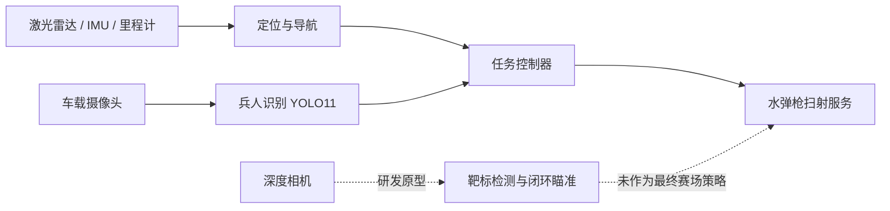
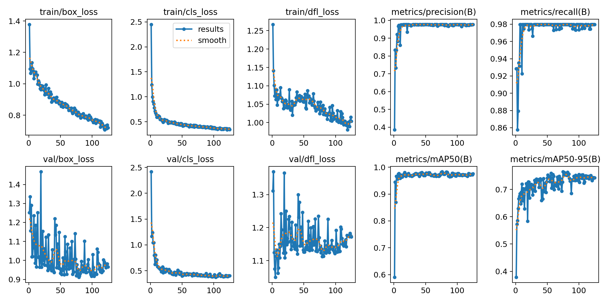
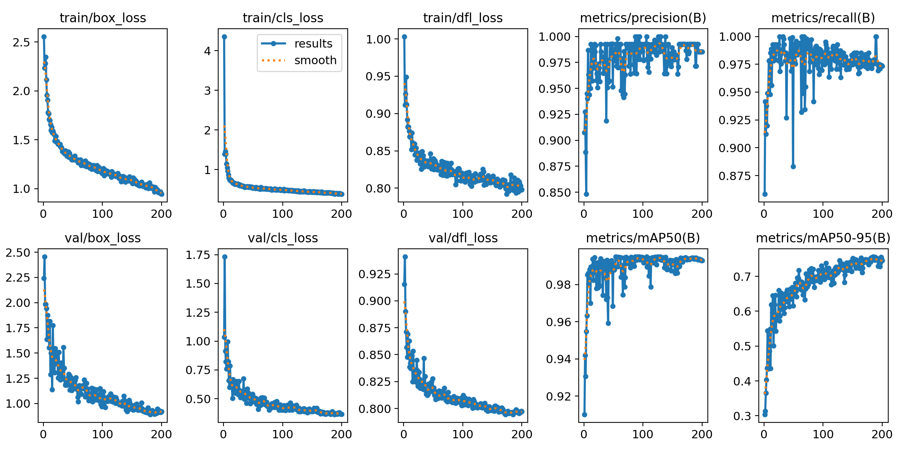

# RAICOM 2025 智能侦察车

[English](README.md) | 简体中文

这是 2025 年睿抗机器人开发者大赛智能侦察项目的工程案例与精选归档。原比赛车辆结合了 ROS 自主导航、YOLO11 兵人识别和水弹枪任务控制。

> 本仓库保存具有代表性的源代码、模型文件、训练记录和工程决策。它不是原始工作盘的完整重建，也不是可完整复现的机器人软件栈或可直接部署的硬件产品。

## 归档状态

| 组成部分 | 状态 |
|---|---|
| 模型权重 | 已保留、完成哈希校验，并由 Git LFS 管理 |
| 训练记录与图表 | 已保留；README 指标已与 CSV 记录核对 |
| 视觉训练与推理入口 | 源码已整理；未在当前归档环境中重新运行 |
| ROS 导航与任务源码 | 历史参考；整理后没有在原车上重新构建和测试 |
| 闭环瞄准原型 | 不完整的实验性代码；未包含外部 YOLOv5 源码和标定数据 |
| 整车部署 | 缺少原始硬件、驱动、标定和运行环境，无法完整复现 |
| 原始数据集 | 因授权和隐私状态无法完全确认，没有公开 |

## 2025 年系统范围

- 比赛车辆使用 ROS Melodic、AMCL、Dijkstra 全局规划和 DWA 局部规划完成场地导航。
- YOLO11 模型用于识别敌方、友方和人质兵人牌，并支持按区域统计。
- 研发阶段探索过基于深度相机的闭环瞄准方案。
- 最终根据实车算力、SLAM 稳定性和电量约束，选择了行为更确定的固定范围扫射方案。

下图概括当时的系统设计，不代表当前仓库源码能够直接执行出完整调用链。



## 我的贡献

仓库所有者是该项目的主要开发者和系统集成人员，主要工作包括：

- ROS 导航配置、赛道点位编排和现场参数调试；
- 兵人与靶标数据准备、YOLO 训练、评估和模型选择；
- 摄像头推理、分区角色统计与任务流程集成；
- 深度相机闭环瞄准实验和最终扫射控制实现；
- 整车联调、赛场问题排查，以及围绕算力、SLAM 稳定性和电量进行方案取舍。

## 结果

下表来自保留训练记录的最后一轮验证结果，不代表独立测试集或赛场成绩。

| 模块 | 模型 | Precision | Recall | mAP50 | mAP50-95 |
|---|---|---:|---:|---:|---:|
| 兵人识别 | YOLO11s | 0.977 | 0.980 | 0.975 | 0.743 |
| 水弹枪靶标 | YOLO11n | 0.985 | 0.973 | 0.993 | 0.746 |

| 兵人识别训练曲线 | 靶标识别训练曲线 |
|---|---|
|  |  |

## 核心代码

- `robot/ros_ws/src/nav_demo/scripts/mission_controller.py`：保留的赛道点位、分区导航参数、识别接口和历史扫射服务接入点；当前有效代码路径并不完整。
- `robot/ros_ws/src/nav_demo/scripts/soldier_detector.py`：单帧采集、YOLO 推理和三类角色统计。
- `robot/ros_ws/src/nav_demo/scripts/gun_sweep_server.py`：带参数校验和默认禁用保护的扫射服务。
- `robot/prototype/auto_aim_controller.py`：仅供参考的深度相机闭环瞄准原型；其外部 YOLOv5 运行环境和标定数据未收录。
- `vision/soldier/` 与 `vision/target/`：可移植的训练、推理和评估入口。

## 仓库结构

```text
.
├─ docs/                  架构、工程取舍、复现边界和整理记录
├─ media/training/        训练曲线、PR 曲线和归一化混淆矩阵
├─ models/                三份可追溯权重（Git LFS）
├─ robot/
│  ├─ prototype/          未进入最终赛场策略的闭环瞄准原型
│  └─ ros_ws/src/         精简后的 catkin 工作区源码
├─ tools/                 不依赖 ROS 的仓库完整性检查
└─ vision/                两个视觉任务的训练、推理和评估入口
```

## 快速查看视觉模型

```bash
git lfs install
git clone <your-repository-url>
cd <repository>

python3 -m venv .venv
source .venv/bin/activate
pip install -r requirements.txt

python vision/soldier/infer.py path/to/image.jpg
python vision/target/infer.py path/to/image.jpg
```

训练与评估需要自行准备数据，并将 `data.example.yaml` 中的占位路径改为本机路径。原始数据集没有公开。

## 归档与复现边界

ROS 代码来自比赛实车备份，目标环境是 Ubuntu 18.04 + ROS Melodic。由于当年的 Python、ROS、驱动和硬件环境没有被完整保存，当前无法重建整套系统。本版本将保留的任务包、底盘包和配置作为历史工程证据展示；已知边界见 `docs/REPRODUCIBILITY.zh-CN.md`。

```bash
python tools/validate_repo.py
```

该命令只检查归档结构、语法、哈希、指标和发布边界，不属于 ROS 构建、系统集成测试或硬件验证。

## 安全说明

`gun_sweep_server.py` 默认 `~armed:=false`，不会接受开火请求。任何水弹发射装置测试都应断开弹药、设置物理安全区，并准备独立急停。不要在人员、动物、玻璃或非授权场地附近测试。

## 说明与许可

- 此仓库不包含主办方提供的车辆模型、竞赛文档、原始数据集和个人信息。保留的 ROS 基线包已在 [`NOTICE.md`](NOTICE.md) 中单独注明来源。
- Ultralytics 依赖及其许可证说明见 `NOTICE.md` 和 `third_party/licenses/`。
- 团队原创代码尚未选择开源许可证。在添加正式 `LICENSE` 前，本仓库仅用于作品展示与技术交流，不自动授予复制、修改或再分发权利。
- 公开前请完成 `docs/PUBLICATION_CHECKLIST.md`。

更多内容：[`系统架构`](docs/ARCHITECTURE.md) · [`工程取舍`](docs/DESIGN_DECISIONS.md) · [`复现说明`](docs/REPRODUCIBILITY.md) · [`模型卡`](models/MODEL_CARD.md)
