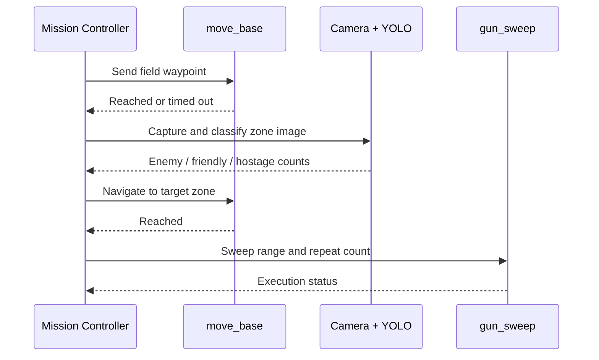

# System Architecture

English | [简体中文](ARCHITECTURE.zh-CN.md)

## Historical system design

The original competition design used ROS navigation as its main execution path. Localization combined LiDAR, IMU, and chassis odometry. The intended mission flow sent field waypoints to `move_base`, captured images in recognition zones, and used a fixed-angle sweep service in target zones.

The sequence below documents that historical design rather than a currently executable trace. The retained `mission_controller.py` preserves route data and sweep-service integration points, but its active archived path contains only part of the route and has the gun invocations commented out.

## Navigation

- AMCL localizes the robot against a known occupancy map.
- GlobalPlanner runs in Dijkstra mode for global path generation.
- DWA handles local obstacle avoidance, with mission-specific velocity and inflation-radius adjustments.
- `car_bringup` provides chassis odometry and EKF configuration.
- The vehicle model package (`mowen`) is kept in the private archive only and is not part of this public edition.

The public edition retains only the `xiaomingPP` map because the archived `nav03_map_server.launch` selects it by default. Other historical or unconfirmed maps remain in the offline archive.

## Vision

Soldier-board training used YOLO11s. The vehicle-deployed weight exposes the labels `red / white / blue / colorful`; the runtime maps them to the competition roles `enemy / hostage / friend`. A separate final training run retained a different four-class schema. Because the two weight files also have different hashes, they are documented as separate artifacts rather than treated as interchangeable.

The retained target-detection training record uses YOLO11n with one class, `target_center`. It comes from the same target-detection development stage as the depth-camera experiment. The surviving controller, however, uses a YOLOv5-style runtime whose external framework files and calibration data are not included. Compatibility between that prototype and the packaged YOLO11 weight has not been revalidated.

## Water-gun strategy

The closed-loop prototype combined target detection, depth measurement, camera-to-launcher offset compensation, servo control, and firing feedback. On the vehicle, switching into the depth-camera and inference workload caused noticeable stalls and could interfere with SLAM after the task. The additional compute and sensor use also increased power draw. The final engineering choice therefore favored the simpler and more predictable sweep strategy. The surviving sweep service records that choice; the archived active mission path is not a complete reconstruction of the competition run.
