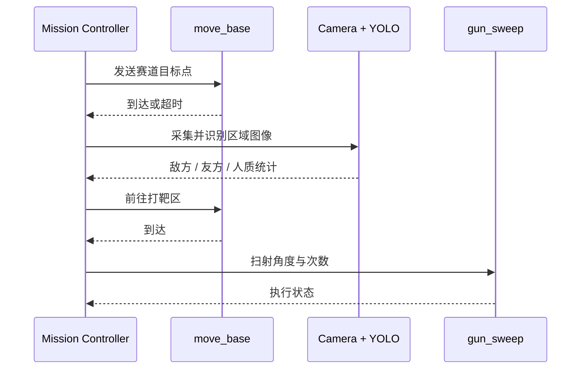

# 系统架构

## 最终赛场链路

最终方案以 ROS 导航为主线。定位系统融合激光雷达、IMU 和底盘里程计；任务控制器按赛道点位调用 `move_base`；车载摄像头在识别区进行兵人推理；到达打靶区后，水弹枪节点执行固定角度范围扫射。

## 导航

- AMCL 负责已知地图定位。
- GlobalPlanner 使用 Dijkstra 模式生成全局路径。
- DWA 完成局部避障，并允许任务控制器按赛区调整速度和膨胀半径。
- `car_bringup` 提供底盘里程计和 EKF 配置；`mowen` 提供 URDF 与可视化模型。

公开版只保留 `xiaomingPP` 地图，因为归档中的 `nav03_map_server.launch` 将它设为默认地图。其他 2023/2024 或未明确使用的地图仍保存在离线总档案中。

## 视觉

兵人识别训练使用 YOLO11s。实车权重原始标签为 `red / white / blue / colorful`，运行脚本按比赛语义合并为 `enemy / hostage / friend`。最后一次训练记录使用过另一套四类名称，因此两份兵人权重被分别保存，不能假定完全等价。

靶标识别训练使用 YOLO11n，类别为 `target_center`。它服务于深度相机闭环瞄准原型，而不是最终扫射方案。

## 水弹枪

闭环原型包含靶标检测、深度测距、安装偏移补偿、舵机控制和开火反馈。实车测试中，深度相机与识别进程切换会引发卡顿，水弹任务结束后还可能影响 SLAM；额外计算和传感器调用也加剧耗电。因此最终选择了行为更确定、计算量更低的扫射服务。
