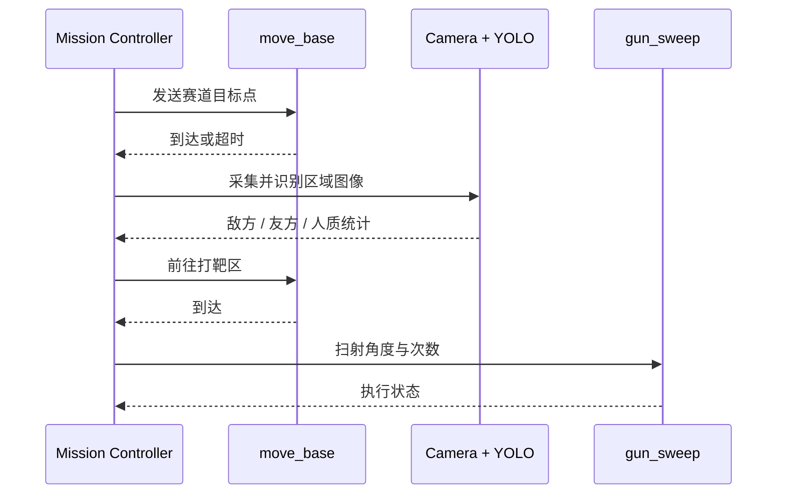

# 系统架构

[English](ARCHITECTURE.md) | 简体中文

## 历史系统设计

原比赛方案以 ROS 导航为主线。定位系统融合激光雷达、IMU 和底盘里程计；设计中的任务流程按赛道点位调用 `move_base`，在识别区采集图像，并在打靶区使用固定角度范围扫射服务。

下列时序图记录的是当时的系统设计，不是当前仓库能够直接执行出的调用轨迹。保留的 `mission_controller.py` 含有赛道数据和扫射服务接入点，但当前有效路径只保留了部分路线，水弹枪调用也处于注释状态。

## 导航

- AMCL 负责已知地图定位。
- GlobalPlanner 使用 Dijkstra 模式生成全局路径。
- DWA 完成局部避障，并允许任务控制器按赛区调整速度和膨胀半径。
- `car_bringup` 提供底盘里程计和 EKF 配置；车模包（`mowen`）因包含主办方提供的内容，仅保存在私有档案中，不在本公开版内。

公开版只保留 `xiaomingPP` 地图，因为归档中的 `nav03_map_server.launch` 将它设为默认地图。其他 2023/2024 或未明确使用的地图仍保存在离线总档案中。

## 视觉

兵人识别训练使用 YOLO11s。实车权重原始标签为 `red / white / blue / colorful`，运行脚本按比赛语义合并为 `enemy / hostage / friend`。最后一次训练记录使用过另一套四类名称，因此两份兵人权重被分别保存，不能假定完全等价。

保留的靶标训练记录使用 YOLO11n，类别为 `target_center`，来自与深度相机实验相同的靶标识别研发阶段。但现存控制器采用 YOLOv5 风格的运行接口，相关外部框架和标定数据没有收录；该原型与仓库中 YOLO11 权重的兼容性没有重新验证。

## 水弹枪

闭环原型包含靶标检测、深度测距、安装偏移补偿、舵机控制和开火反馈。实车测试中，深度相机与识别进程切换会引发卡顿，水弹任务结束后还可能影响 SLAM；额外计算和传感器调用也加剧耗电。因此最终选择了行为更确定、计算量更低的扫射策略。现存扫射服务记录了这一选择，但归档中的有效任务路径并不是完整赛场流程的重建。
